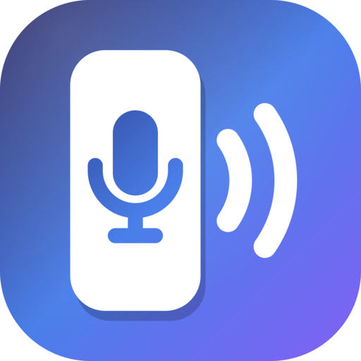
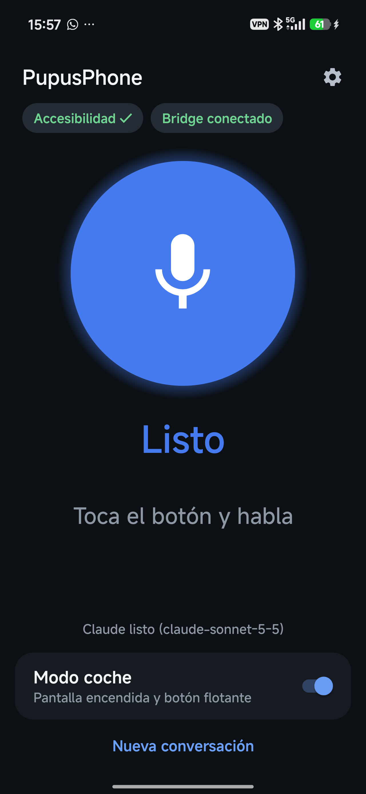

<p align="center"></p>

# PupusPhone

Hands-free voice assistant that lets **Claude control your Android phone**: open apps, play
music, queue songs, read and reply to messages, navigate — by voice, like a phone call.

It is the phone counterpart of the Chrome and Desktop MCP servers: an Android app exposes the
screen and input through an `AccessibilityService`, an MCP server turns that into tools, and a
voice bridge keeps one Claude Code process talking to you.

<p align="center"></p>

```text
"Add Don't Stop Me Now by Queen to the queue"
  -> open_url spotify:search:...  -> tap_text "More options"  -> tap_text "Add to queue"
  <- "Done, it's in your Spotify queue."
```

## How it works

```text
Android app (Kotlin)                         Bridge + MCP (Node, no native deps)
  big push-to-talk button                      WebSocket :8766  <-- utterances / spoken replies
  speech-to-text, text-to-speech  <-------->   one persistent `claude -p` process (stream-json)
  AccessibilityService + HTTP :8765  <------   pupusphone-mcp: read_screen, tap_text, type_text,
    (screen tree, gestures, intents, media)       open_url, media, screenshot, ...
```

Two ways to run the bridge:

| Mode | Where the bridge runs | Network |
|---|---|---|
| With a PC | Your computer | [Tailscale](https://tailscale.com) between PC and phone (works on mobile data) |
| Phone only | [Termux](https://termux.dev) on the phone itself | Loopback only, nothing exposed |

## Requirements

- Android 11+ (arm64). Tested on a Xiaomi 15T (HyperOS 3, Android 16).
- Your own [Claude Code](https://docs.claude.com/en/docs/claude-code) login (Claude subscription
  or `ANTHROPIC_API_KEY`). PupusPhone does not ship or proxy any credentials: it drives the
  Claude Code CLI you install and log into yourself. Use it according to Anthropic's terms.
- PC mode: Node.js ≥ 22.18. Phone-only mode: Termux from F-Droid or GitHub (not Google Play).

## Setup

1. **App.** Build (`cd android && ./gradlew assembleDebug`) or download the APK from Releases.
   Install it and grant microphone and notifications. On Android 13+ a sideloaded app needs
   *App info › ⋮ › Allow restricted settings* before its accessibility service can be enabled;
   then enable *PupusPhone* in Accessibility settings. Set battery usage to *Unrestricted*.
   See [android/README.md](android/README.md).
2. **Bridge.**
   - *Phone only (no PC):* install Termux from F-Droid or GitHub (not Google Play), tap
     *Ajustes › Conexión › Configurar Termux* in the app and paste the copied command into
     Termux. When it finishes, run `claude` once to log in. Full guide, including battery
     settings per brand: [docs/termux.md](docs/termux.md).
   - *PC:* `cd pc && npm install`, fill `.env` from [`.env.example`](pc/.env.example), `npm run bridge`.
     Details in [pc/README.md](pc/README.md).
3. **Connect.** Phone only: *Configurar Termux* already set the URL and token; grant the Termux
   permission in *Ajustes › Conexión*. PC: set the bridge URL and token in the app. Then turn on
   *Modo coche* and tap the button.

You can also use the MCP server alone from any Claude Code session on your PC
(`claude mcp add ...`, see [pc/README.md](pc/README.md)).

## Security

The device API can control the whole phone. It requires a random 256-bit token, listens only on
loopback and the Tailscale interface (LAN only if you enable it), and is never exposed to the
internet. The assistant asks for confirmation before sending messages or calling, and never
unlocks the phone or touches security settings.

## Status

Personal project, early stage. Protocol: [docs/protocol.md](docs/protocol.md). Plan:
[docs/PLAN.md](docs/PLAN.md) (Spanish).

## License

[MIT](LICENSE)
